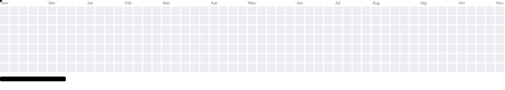

<div align="center">


<picture>
  <source media="(prefers-color-scheme: dark)" srcset="https://readme-typing-svg.demolab.com?font=Fira+Code&weight=500&size=20&pause=1200&color=00FF41&center=true&vCenter=true&width=700&height=40&lines=%24+whoami+%E2%86%92+Red+Team+intern;%24+focus+%E2%86%92+Offensive+Engineering+%26+Development;%24+hobby-projects+%E2%86%92+robotics%2C+malware%2C+general+dev;%24+.%2Foscp+--target+summer-2027"/>
  
</picture>

<br/>

<a href="https://www.linkedin.com/in/alejandro-mamán-lópez-mingo-289405384"></a>
<a href="mailto:alej.mlm03@gmail.com"></a>

</div>

<br/>

Fourth-year **Software Engineering** student at **U-TAD** (Madrid) with a specialization in **Cybersecurity**.
I currently work as a **Red Team intern**, and I build software ranging from full-stack web apps to security tooling. Most of my free time goes into labs, Hack The Box and learning how things break (and how to spot it afterwards, thanks to a forensics background).

```
Right now       →  Red Team intern
Current focus   →  Red Teaming · Active Directory · Digital Forensics
Training        →  HTB Academy · HTB Labs & Sherlocks · home lab (AD)
Next certs      →  OSCP (target: summer 2027) · CRTP
```

<h3 align="center">-------------------- Cybersecurity --------------------</h3>

<table>
<tr>
<td width="50%" valign="top">
<h4><a href="https://github.com/D1n0sXIX/U-Tad-Hacking-Etico">🕵️ Ethical Hacking</a></h4>
<sub><code>Python</code></sub><br/>
Labs, notes and write-ups from U-TAD's Ethical Hacking course, following the kill chain from recon to persistence.
</td>
<td width="50%" valign="top">
<h4><a href="https://github.com/D1n0sXIX/Analisis-Forense">🔬 Digital Forensics</a></h4>
<sub><code>Shell</code></sub><br/>
Forensic analysis CTF-style: evidence, artifacts and flag hunting.
</td>
</tr>
<tr>
<td width="50%" valign="top">
<h4><a href="https://github.com/D1n0sXIX/HTB-Journey">📦 HTB Journey</a></h4>
<sub><code>HTML</code></sub><br/>
Hack The Box write-ups, Academy notes and pentesting scripts.
</td>
<td width="50%" valign="top">
<h4><a href="https://github.com/D1n0sXIX/Practica2Ciber">🔎 Domain Recon Tool</a></h4>
<sub><code>Python</code></sub><br/>
Domain reconnaissance: WHOIS, email extraction, port scan, NS/MX queries and Have I Been Pwned checks.
</td>
</tr>
<tr>
<td width="50%" valign="top">
<h4><a href="https://github.com/D1n0sXIX/Hacked-Now-S3">🚨 Hacked Now</a></h4>
<sub><code>Next.js</code></sub><br/>
Help forum for people hit by attacks or data leaks: community/expert answers, breach news and a premium AI assistant (<a href="https://github.com/D1n0sXIX/Hacked-Now-S2">Sprint 2 pitch</a>).
</td>
<td width="50%" valign="top">
<h4><a href="https://github.com/D1n0sXIX/Proyecto-Final-IA">🧠 Security Events ML</a></h4>
<sub><code>Jupyter</code></sub><br/>
Supervised + semi-supervised ML to detect security events in network/system data and rank alerts by risk.
</td>
</tr>
</table>

<h3 align="center">-------------------- Random Projects --------------------</h3>

<table>
<tr>
<td width="50%" valign="top">
<h4><a href="https://github.com/D1n0sXIX/practica-final-web">📋 BildyApp API</a></h4>
<sub><code>Node.js</code> · <code>Express</code> · <code>MongoDB</code></sub><br/>
REST API for delivery notes between clients and providers: JWT, Swagger, Jest, Socket.IO and Docker (<a href="https://github.com/D1n0sXIX/Practica-Intermedia-AppWeb-Intermedia">first iteration</a>).
</td>
<td width="50%" valign="top">
<h4><a href="https://github.com/D1n0sXIX/Practica-Kubernetes">☸️ Kubernetes on AWS</a></h4>
<sub><code>Kubernetes</code> · <code>AWS</code> · <code>NFS</code></sub><br/>
Distributed file-management system (broker + file servers) on a 3-node cluster with shared storage across replicas.
</td>
</tr>
<tr>
<td width="50%" valign="top">
<h4><a href="https://github.com/D1n0sXIX/Servidor-Feudal-Discord">⚔️ Servidor Feudal</a></h4>
<sub><code>Python</code></sub><br/>
Medieval-themed Discord bot with ranks, activity points, duels and special powers.
</td>
<td width="50%" valign="top">
<h4><a href="https://github.com/D1n0sXIX/Proyecto_Final_SistemasOperativos">💾 ext Filesystem Simulator</a></h4>
<sub><code>C</code></sub><br/>
Operating Systems final project: simulates an ext-style file system over a partition image.
</td>
</tr>
<tr>
<td width="50%" valign="top">
<h4><a href="https://github.com/D1n0sXIX/ProyectoFinal-DisSoftware">🎮 RPG in Java</a></h4>
<sub><code>Java</code></sub><br/>
Software Design final project: a role-playing game built around design patterns.
</td>
<td width="50%" valign="top">
<h4>📚 More coursework</h4>
<sub><code>React</code> · <code>Next.js</code> · <code>C++</code> · <code>SQL</code></sub><br/>
Client-side web, distributed systems and databases live in my other repositories.
</td>
</tr>
</table>

<h3 align="center">-------------------- Certifications Roadmap --------------------</h3>

| Status | Certification | Focus |
|:---:|---|---|
| 🎯 | **OSCP** – OffSec Certified Professional | Hands-on penetration testing — exam planned for summer 2027 |
| 🎯 | **CRTP** – Certified Red Team Professional | Active Directory attacks |

<h3 align="center">-------------------- Tech Stack --------------------</h3>

<div align="center">

**Offensive Security & Forensics**<br/>


**Languages for tooling**<br/>


**Systems & Infrastructure**<br/>
<br/>


**Software Development**<br/>


**AI & Hardware**<br/>


</div>

<br/>

<div align="center">

<picture>
  <source media="(prefers-color-scheme: dark)" srcset="https://raw.githubusercontent.com/D1n0sXIX/D1n0sXIX/output/breakout-contribution-graph-dark.svg"/>
  <source media="(prefers-color-scheme: light)" srcset="https://raw.githubusercontent.com/D1n0sXIX/D1n0sXIX/output/breakout-contribution-graph.svg"/>
  
</picture>

</div>

<details>
<summary>🇪🇸 Versión en Español</summary>

<br/>

Estudiante de cuarto año de **Ingeniería del Software** en **U-TAD** (Madrid), con especialización en **Ciberseguridad**.
Actualmente trabajo como **becario de Red Team** y desarrollo desde aplicaciones web full-stack hasta herramientas de seguridad. Dedico gran parte de mi tiempo libre a laboratorios, Hack The Box y a entender cómo se rompen las cosas (y cómo detectarlo después, gracias a mi base de forense).

```
Ahora mismo       →  Becario de Red Team
Enfoque actual    →  Red Teaming · Active Directory · Forense Digital
Entrenamiento     →  HTB Academy · HTB Labs y Sherlocks · laboratorio propio (AD)
Próximas certs    →  OSCP (objetivo: verano de 2027) · CRTP
```

**Proyectos destacados:** una herramienta de reconocimiento de dominios en Python, Hacked Now (foro de ayuda ante ciberataques, en Next.js), ML para detectar eventos de seguridad, una API REST completa (BildyApp: Express, JWT, Swagger, Jest, Socket.IO y Docker), un sistema de ficheros distribuido sobre Kubernetes en AWS, un simulador de sistema de ficheros ext en C, un RPG en Java con patrones de diseño y un bot de Discord de temática medieval.

</details>
